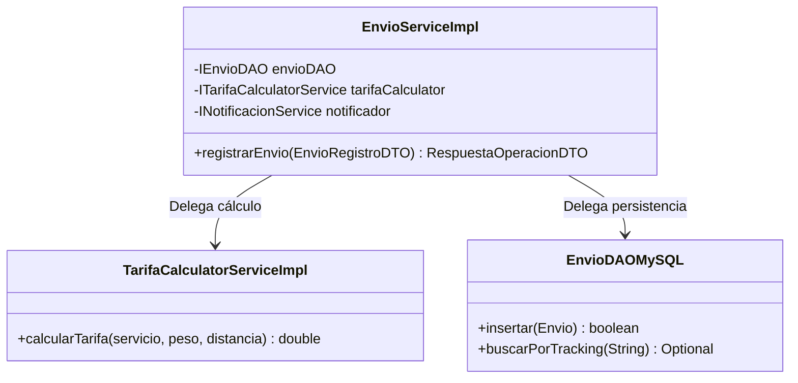
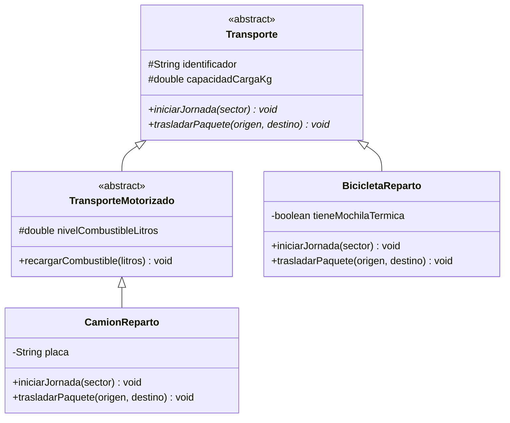
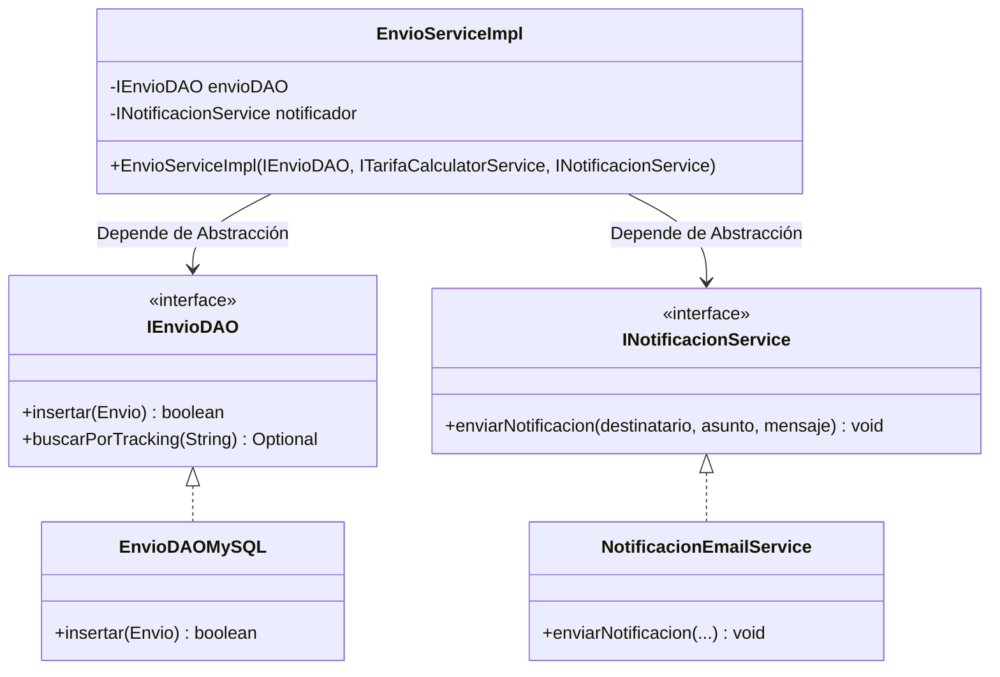
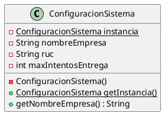
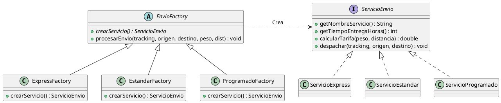
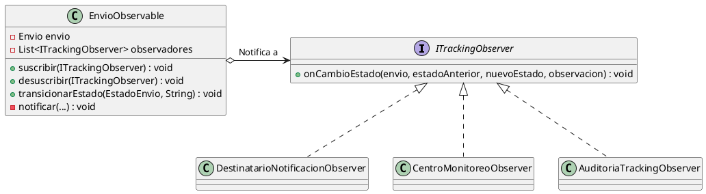

# UNIVERSIDAD TECNOLÓGICA DEL PERÚ (UTP)
## FACULTAD DE INGENIERÍA
### CURSO: DISEÑO DE PATRONES
---

# INFORME TÉCNICO - PRIMER AVANCE (SEMANAS 1 A 4)
## PROYECTO: PLATAFORMA DE LOGÍSTICA Y SEGUIMIENTO DE ENVÍOS EN TIEMPO REAL

---

## ÍNDICE GENERAL

1. [INTRODUCCIÓN Y CONTEXTO EMPRESARIAL](#1-introducción-y-contexto-empresarial)
   - 1.1 Descripción del Caso de Negocio
   - 1.2 Problemática y Desafíos Logísticos
   - 1.3 Objetivos del Primer Avance
2. [ARQUITECTURA DE SOFTWARE VS. PATRONES DE DISEÑO (SEMANA 4)](#2-arquitectura-de-software-vs-patrones-de-diseño)
   - 2.1 Niveles de Abstracción y Diferencias
   - 2.2 Estructura Arquitectónica por Capas del Proyecto
3. [APLICACIÓN DE PRINCIPIOS DE DISEÑO Y PRINCIPIOS SOLID (SEMANAS 1, 2 Y 3)](#3-aplicación-de-principios-de-diseño-y-principios-solid)
   - 3.1 Integración Natural de SOLID en las Capas de la Aplicación
   - 3.2 Principio de Responsabilidad Única (SRP)
   - 3.3 Principio Abierto / Cerrado (OCP)
   - 3.4 Principio de Sustitución de Liskov (LSP)
   - 3.5 Principio de Segregación de Interfaces (ISP)
   - 3.6 Principio de Inversión de Dependencias (DIP) e Inyección de Dependencias
4. [CATÁLOGO Y CLASIFICACIÓN DE PATRONES GoF (GANG OF FOUR)](#4-catálogo-y-clasificación-de-patrones-gof)
   - 4.1 Historia y Fundamento de los Patrones GoF
   - 4.2 Clasificación de los 23 Patrones GoF y Pertinencia en Logística
5. [ESPECIFICACIÓN FORMAL DE PATRONES IMPLEMENTADOS EN EL AVANCE 1](#5-especificación-formal-de-patrones-implementados)
   - 5.1 Patrón Creacional: Singleton (`ConfiguracionSistema` / `ConexionBD`)
   - 5.2 Patrón Creacional: Factory Method (`EnvioFactory` / `ServicioEnvio`)
   - 5.3 Patrón de Comportamiento: Observer (`EnvioObservable` / `ITrackingObserver`)
6. [DISEÑO Y SCRIPT DE BASE DE DATOS (MYSQL / XAMPP)](#6-diseño-y-script-de-base-de-datos)
7. [ESTRUCTURA DEL PROYECTO Y GUÍA DE EJECUCIÓN](#7-estructura-del-proyecto-y-guía-de-ejecución)
8. [CONCLUSIONES Y METACOGNICIÓN (FORMATO UTP)](#8-conclusiones-y-metacognición)

---

## 1. INTRODUCCIÓN Y CONTEXTO EMPRESARIAL

### 1.1 Descripción del Caso de Negocio
Una empresa logística de escala nacional orientada al transporte y distribución de paquetes y encomiendas experimenta un incremento masivo en la demanda debido a la expansión del e-commerce. Para optimizar su operación, la empresa gestiona diversas modalidades de servicio:
- **Entrega Express:** Distribución urgente en menos de 12 a 24 horas con máxima prioridad en ruta.
- **Envío Estándar:** Proceso consolidado de distribución regular interurbana.
- **Mensajería Programada:** Citas agendadas por el cliente en franjas horarias exactas.
- **Recojo en Tienda / Casillero:** Entregas en puntos autorizados y casilleros automatizados.
- **Transporte Interprovincial:** Movilización de encomiendas de alto tonelaje a nivel nacional.

### 1.2 Problemática y Desafíos Logísticos
1. **Falta de Trazabilidad en Tiempo Real:** Dificultad para conocer el estado y geolocalización precisa de los envíos en cada fase (`REGISTRADO`, `RECOGIDO`, `CLASIFICADO`, `EN_RUTA`, `OBSERVADO`, `ENTREGADO`).
2. **Alto Acoplamiento del Código:** Sistemas antiguos donde cualquier cambio en el cálculo de tarifas o en la integración con un nuevo proveedor de SMS/Email obligaba a modificar clases críticas del negocio.
3. **Múltiples Actores con Roles Heterogéneos:** Agentes de ventanilla, operarios de clasificación en almacén, repartidores en ruta móvil y clientes corporativos interactúan con el sistema bajo requerimientos totalmente distintos.
4. **Dependencia Rígida de Bases de Datos:** Código fuertemente amarrado a sentencias SQL directas, impidiendo modularidad y testing unitario.

### 1.3 Objetivos del Primer Avance
- Implementar una **arquitectura por capas estándar (`controller`, `dao`, `dto`, `model`, `patterns`, `persistence`, `service`, `ui`, `util`)**.
- Aplicar los **5 Principios SOLID (SRP, OCP, LSP, ISP, DIP)** de forma nativa e integrada en las capas de negocio.
- Formalizar los **Patrones de Diseño GoF (Singleton, Factory Method, Observer)** para dar soporte al ciclo de vida y despacho logístico.
- Configurar el esquema relacional en **MySQL (XAMPP / phpMyAdmin)**.

---

## 2. ARQUITECTURA DE SOFTWARE VS. PATRONES DE DISEÑO

### 2.1 Niveles de Abstracción y Diferencias
Es indispensable distinguir el rol de los patrones arquitectónicos frente a los patrones de diseño:

| Criterio | Patrones Arquitectónicos | Patrones de Diseño (GoF) |
| :--- | :--- | :--- |
| **Nivel de Abstracción** | **Macro / Global:** Define la organización de alto nivel del sistema, subsistemas y la separación de responsabilidades a gran escala. | **Micro / Local:** Resuelve problemas puntuales de diseño, composición e interacción entre clases y objetos dentro de un módulo. |
| **Enfoque** | Estructura el flujo de información general (Capas, MVC, Hexagonal, Microservicios). | Provee soluciones reutilizables a problemas recurrentes de instanciación, acoplamiento y comportamiento. |
| **Impacto** | Difícil de cambiar una vez establecida la base de la aplicación. | Fácil de refactorizar o extender a nivel de clase o paquete sin alterar la arquitectura global. |
| **Ejemplos** | N-Capas (Layered Architecture), Arquitectura Limpia, Microservicios. | Singleton, Factory Method, Observer, Strategy, Adapter, Decorator, State. |

### 2.2 Estructura Arquitectónica por Capas del Proyecto
El sistema adopta una **Arquitectura en Capas (Layered Architecture)** con separación de responsabilidades e inversión de control:

```
+-------------------------------------------------------------+
|                 CAPA DE PRESENTACIÓN / UI                   |
|                      (ConsolaView)                          |
+------------------------------+------------------------------+
                               |
+------------------------------v------------------------------+
|                    CAPA DE CONTROLADORES                    |
|             (EnvioController, TrackingController)           |
+------------------------------+------------------------------+
                               |
+------------------------------v------------------------------+
|                    CAPA DE SERVICIOS                        |
|       (EnvioServiceImpl, TarifaCalculatorServiceImpl,       |
|    NotificacionEmailService, OperadorAlmacenServiceImpl)    |
+------------------------------+------------------------------+
                               |
+------------------------------v------------------------------+
|            CAPA DE ACCESO A DATOS (DAO / PERSISTENCIA)      |
|             (IEnvioDAO, EnvioDAOMySQL, ConexionBD)          |
+------------------------------+------------------------------+
                               |
+------------------------------v------------------------------+
|               CAPA DE DATOS: MySQL / XAMPP                  |
|                   (db_logistica_envios)                     |
+-------------------------------------------------------------+
```

---

## 3. APLICACIÓN DE PRINCIPIOS SOLID

Los principios SOLID **no se implementan como carpetas o clases aisladas**, sino que constituyen el estándar de calidad y desacoplamiento en las capas de la aplicación:

### 3.1 Principio de Responsabilidad Única (SRP)
> *"Una clase debe tener una sola razón para cambiar."*

- **Aplicación en el proyecto:**
  - `TarifaCalculatorServiceImpl`: Su única razón para cambiar es una modificación en las reglas de costeo o recargos por peso y distancia.
  - `EnvioDAOMySQL`: Su única razón para cambiar son las sentencias SQL o el esquema de persistencia en MySQL.
  - `EnvioServiceImpl`: Orquesta el flujo de negocio coordinando cálculos, persistencia y notificaciones, sin implementar directamente lógica matemática ni SQL.



---

### 3.2 Principio Abierto / Cerrado (OCP)
> *"El software debe estar abierto para la extensión, pero cerrado para la modificación."*

- **Aplicación en el proyecto:**
  - **Canales de Notificación:** Para incorporar un nuevo canal (como Telegram o Push Notifications), basta con crear una nueva clase que implemente `INotificacionService` (ej. `NotificacionTelegramService`), sin modificar ni una sola línea de `EnvioServiceImpl` ni de los controladores.
  - **Servicios de Envío:** Nuevas variantes de entrega (ej. *Dron Delivery*) se agregan creando subclases en `patterns/factory` sin alterar el flujo de despacho.

---

### 3.3 Principio de Sustitución de Liskov (LSP)
> *"Los objetos de una clase derivada deben poder sustituir a los de su clase base sin romper el comportamiento esperado."*

- **Aplicación en el paquete `model/transporte/`:**
  - Si forzáramos a que toda unidad de reparto implemente `recargarCombustible(litros)`, una `BicicletaReparto` violaría LSP al lanzar `UnsupportedOperationException`.
  - **Diseño correcto:** `Transporte` define operaciones universales (`iniciarJornada`, `trasladarPaquete`). Se crea la clase intermedia `TransporteMotorizado` de la que hereda `CamionReparto`. De esta manera, cualquier `Transporte` (`CamionReparto` o `BicicletaReparto`) puede sustituir a la clase base de forma polimórfica sin errores.



---

### 3.4 Principio de Segregación de Interfaces (ISP)
> *"Los clientes no deben ser obligados a depender de métodos que no utilizan."*

- **Aplicación en la capa `service/`:**
  - En lugar de una interfaz gigantesca con métodos de todos los actores del sistema logístico, se crearon interfaces segregadas y específicas:
    - `IOperadorAlmacenService`: `recepcionarPaquete()`, `clasificarPaquete()`, `consolidarLote()`.
    - `IRepartidorRutaService`: `iniciarReparto()`, `registrarEntregaExitosa()`, `reportarIncidencia()`.
    - `IEnvioService`: `registrarEnvio()`, `consultarTracking()`, `listarTodos()`.

---

### 3.5 Principio de Inversión de Dependencias (DIP)
> *"Los módulos de alto nivel no deben depender de módulos de bajo nivel; ambos deben depender de abstracciones."*

- **Aplicación en `EnvioServiceImpl` y `AppLogistica`:**
  - La clase de alto nivel `EnvioServiceImpl` no instancia con `new` a `EnvioDAOMySQL` ni a `NotificacionEmailService`.
  - Depende estrictamente de las interfaces `IEnvioDAO`, `ITarifaCalculatorService` e `INotificacionService`.
  - La clase `AppLogistica` (Composition Root) inyecta las implementaciones concretas mediante el constructor.



---

## 4. CATÁLOGO Y CLASIFICACIÓN DE PATRONES GoF

### 4.1 Historia y Fundamento
En 1994, Erich Gamma, Richard Helm, Ralph Johnson y John Vlissides ("Gang of Four" - GoF) compilaron los **23 patrones de diseño clásicos** para evitar "reinventar la rueda" y formalizar un vocabulario estandarizado en la ingeniería de software.

### 4.2 Clasificación de los 23 Patrones GoF y Aplicación en Logística

| Categoría | Patrón GoF | Propósito General | Aplicación en la Plataforma Logística |
| :--- | :--- | :--- | :--- |
| **Creacionales** | **Singleton** | Única instancia con punto de acceso global. | Conexión JDBC (`ConexionBD`) y políticas globales (`ConfiguracionSistema`). |
| | **Factory Method** | Delega la instanciación a subclases creadoras. | Creación de guías según el tipo de servicio (Express, Estándar, Programado). |
| | **Abstract Factory** | Crea familias de objetos relacionados. | Creación de flotas de vehículos e interfaces por región geográfica. |
| | **Builder** | Construye objetos complejos paso a paso. | Construcción de manifiestos de carga con múltiples paquetes. |
| | **Prototype** | Clona instancias existentes. | Duplicación rápida de plantillas de envíos recurrentes corporativos. |
| **Estructurales** | **Adapter** | Conecta interfaces incompatibles. | Integración con APIs externas heterogéneas de mapas GPS y firmas digitales. |
| | **Bridge** | Desacopla abstracción de implementación. | Separación entre el tipo de alerta logística y el protocolo de red. |
| | **Composite** | Jerarquías parte-todo en árbol. | Agrupación de sobres y paquetes dentro de sacas y contenedores. |
| | **Decorator** | Añade responsabilidades dinámicamente. | Servicios adicionales al paquete (Seguro de carga, embalaje especial). |
| | **Facade** | Interfaz simplificada a un subsistema complejo. | Fachada única de despacho que interactúa con almacén, rutas y cobro. |
| | **Flyweight** | Comparte estado intrínseco para ahorrar memoria. | Reutilización de coordenadas de distritos en el mapa de reparto. |
| | **Proxy** | Control de acceso mediante intermediario. | Caché y seguridad en consultas públicas de tracking para evitar sobrecarga. |
| **Comportamiento**| **Chain of Resp.** | Cadena de manejadores de peticiones. | Pipeline de validación de paquetes (peso, dimensiones, cobertura, pago). |
| | **Command** | Encapsula una acción como objeto. | Registro de acciones de almacén con soporte de reversión (Undo). |
| | **Interpreter** | Gramática e intérprete de expresiones. | Reglas dinámicas de descuentos para clientes corporativos. |
| | **Iterator** | Recorrido secuencial de colecciones. | Recorrido optimizado de paradas de entrega en la ruta del repartidor. |
| | **Mediator** | Centraliza comunicación entre objetos. | Torre de control que coordina almacenes, móviles y notificaciones. |
| | **Memento** | Captura y restaura estados de un objeto. | Guardado de checkpoints de ruta ante desvíos o emergencias viales. |
| | **Observer** | Notificación reactiva 1 a N ante cambios de estado. | Trazabilidad en vivo: notifica a destinatarios, dashboards de monitoreo y logs inmutables. |
| | **State** | Cambia el comportamiento según el estado interno. | Transiciones del ciclo de vida del envío (`REGISTRADO` -> `EN_RUTA` -> `ENTREGADO`). |
| | **Strategy** | Algoritmos intercambiables en ejecución. | Selección de algoritmo de ruta óptima (Ruta más rápida vs. Ruta con menos peajes). |
| | **Template Method**| Esqueleto de algoritmo delegando pasos a subclases. | Proceso estandarizado de admisión de paquetes con pasos específicos por tipo. |
| | **Visitor** | Operaciones externas sobre estructuras de objetos. | Cálculo de reportes de auditoría tributaria y métricas de rendimiento SLA. |

---

## 5. ESPECIFICACIÓN FORMAL DE PATRONES IMPLEMENTADOS

### 5.1 Patrón Creacional: Singleton
- **Clases:** `com.logistica.patterns.singleton.ConfiguracionSistema` y `com.logistica.persistence.ConexionBD`.
- **Problema que resuelve:** Evitar múltiples instancias de configuración o conexiones dispersas que consuman recursos o provoquen inconsistencias en parámetros como el SLA de entrega o las credenciales de base de datos.
- **Solución:** Constructor privado, atributo estático privado y método `getInstancia()` sincronizado (`Thread-Safe`).



---

### 5.2 Patrón Creacional: Factory Method
- **Clases:** Paquete `com.logistica.patterns.factory`.
- **Problema que resuelve:** El sistema debe procesar envíos con reglas de entrega y cálculo distintas (Express, Estándar, Programado) sin que la capa superior se acople a las clases concretas.
- **Solución:** La clase abstracta `EnvioFactory` define el método abstracto `crearServicio()`. Subclases como `ExpressFactory`, `EstandarFactory` y `ProgramadoFactory` instancian el producto adecuado.



---

### 5.3 Patrón de Comportamiento: Observer
- **Clases:** Paquete `com.logistica.patterns.observer`.
- **Problema que resuelve:** Cuando un paquete pasa de un estado a otro (ej. `EN_RUTA` a `OBSERVADO` o `ENTREGADO`), diversos componentes deben enterarse en tiempo real sin estar fuertemente acoplados a la entidad `Envio`.
- **Solución:** `EnvioObservable` (Subject) gestiona una lista de `ITrackingObserver` y los notifica en cascada cada vez que se ejecuta `transicionarEstado()`.
  - `DestinatarioNotificacionObserver`: Envía mensajes personalizados al cliente.
  - `CentroMonitoreoObserver`: Actualiza la telemetría del dashboard y activa alarmas en caso de incidencias.
  - `AuditoriaTrackingObserver`: Registra la traza inmutable con fecha y hora.



---

## 6. DISEÑO Y SCRIPT DE BASE DE DATOS (MYSQL / XAMPP)

El archivo `database/schema_logistica.sql` contiene la definición DDL y DML estructurada para MySQL:

```sql
CREATE DATABASE IF NOT EXISTS db_logistica_envios;
USE db_logistica_envios;

-- 1. Tabla de Catálogo de Servicios
CREATE TABLE servicios_envio (
    id_servicio INT AUTO_INCREMENT PRIMARY KEY,
    codigo VARCHAR(20) NOT NULL UNIQUE,
    nombre VARCHAR(100) NOT NULL,
    tarifa_base DECIMAL(10,2) NOT NULL,
    tiempo_estimado_horas INT NOT NULL
);

-- 2. Tabla de Usuarios / Actores
CREATE TABLE usuarios (
    id_usuario INT AUTO_INCREMENT PRIMARY KEY,
    documento VARCHAR(20) NOT NULL UNIQUE,
    nombre VARCHAR(100) NOT NULL,
    apellidos VARCHAR(100) NOT NULL,
    email VARCHAR(120) NOT NULL UNIQUE,
    rol ENUM('ADMIN', 'OPERADOR_ALMACEN', 'REPARTIDOR', 'CLIENTE_CORP', 'DESTINATARIO') NOT NULL
);

-- 3. Tabla Principal de Envíos
CREATE TABLE envios (
    id_envio INT AUTO_INCREMENT PRIMARY KEY,
    codigo_tracking VARCHAR(30) NOT NULL UNIQUE,
    id_servicio INT NOT NULL,
    id_remitente INT NOT NULL,
    nombre_destinatario VARCHAR(150) NOT NULL,
    direccion_destino VARCHAR(255) NOT NULL,
    telefono_destinatario VARCHAR(20) NOT NULL,
    email_destinatario VARCHAR(120),
    peso_kg DECIMAL(6,2) NOT NULL,
    costo_total DECIMAL(10,2) NOT NULL,
    estado_actual ENUM('REGISTRADO', 'RECOGIDO', 'EN_TRANSITO', 'CLASIFICADO', 'EN_RUTA', 'ENTREGADO', 'OBSERVADO', 'REPROGRAMADO', 'DEVUELTO') DEFAULT 'REGISTRADO',
    fecha_registro TIMESTAMP DEFAULT CURRENT_TIMESTAMP,
    FOREIGN KEY (id_servicio) REFERENCES servicios_envio(id_servicio),
    FOREIGN KEY (id_remitente) REFERENCES usuarios(id_usuario)
);

-- 4. Tabla de Historial y Trazabilidad de Estados
CREATE TABLE historial_estados (
    id_historial INT AUTO_INCREMENT PRIMARY KEY,
    id_envio INT NOT NULL,
    estado ENUM('REGISTRADO', 'RECOGIDO', 'EN_TRANSITO', 'CLASIFICADO', 'EN_RUTA', 'ENTREGADO', 'OBSERVADO', 'REPROGRAMADO', 'DEVUELTO') NOT NULL,
    ubicacion VARCHAR(150) NOT NULL,
    observacion TEXT,
    fecha_evento TIMESTAMP DEFAULT CURRENT_TIMESTAMP,
    FOREIGN KEY (id_envio) REFERENCES envios(id_envio) ON DELETE CASCADE
);
```

---

## 7. ESTRUCTURA DEL PROYECTO Y GUÍA DE EJECUCIÓN

### 7.1 Estructura en Maven / Java
```
src/main/java/com/logistica/
├── controller/ (EnvioController, TrackingController)
├── dao/ (IEnvioDAO, IUsuarioDAO, impl/EnvioDAOMySQL, impl/UsuarioDAOMySQL)
├── dto/ (EnvioRegistroDTO, TrackingEventoDTO, RespuestaOperacionDTO)
├── model/ (Envio, EstadoEnvio, Usuario, RolUsuario, transporte/*)
├── patterns/ (singleton/*, factory/*, observer/*)
├── persistence/ (ConexionBD)
├── service/ (IEnvioService, ITarifaCalculatorService, INotificacionService, impl/*)
├── ui/ (ConsolaView)
├── util/ (GeneradorCodigo, ValidadorDatos)
└── AppLogistica.java
```

### 7.2 Pasos de Compilación y Ejecución
1. **Compilar:**
   ```powershell
   javac -encoding UTF-8 -d bin (Get-ChildItem -Recurse -Filter *.java src | ForEach-Object { $_.FullName })
   ```
2. **Ejecutar:**
   ```powershell
   java -cp bin com.logistica.AppLogistica
   ```

---

## 8. CONCLUSIONES Y METACOGNICIÓN

### 8.1 Conclusiones
1. La arquitectura por capas implementada demuestra que los **Principios SOLID** no son conceptos abstractos ni clases aisladas, sino la base estructural de los servicios, repositorios DAO y modelos del sistema logístico.
2. La distinción entre **Patrones Arquitectónicos** (división en capas) y **Patrones de Diseño** (GoF) asegura una separación clara entre la estructura global y las soluciones tácticas a nivel de objeto.
3. Los patrones **Singleton**, **Factory Method** y **Observer** resuelven directamente los desafíos de configuración global, polimorfismo en creación de guías y trazabilidad reactiva en tiempo real.

### 8.2 Metacognición (Rúbrica UTP)
- **¿Qué he aprendido?** A estructurar un proyecto de software empresarial desacoplado, aplicando principios SOLID y patrones GoF sobre un caso de logística real.
- **¿Cómo lo he aprendido?** Mediante la descomposición del problema de negocio, el diseño por capas (Controller, DAO, DTO, Model, Service, Patterns) y la codificación práctica en Java con base de datos MySQL.
- **¿Para qué me ha servido?** Para desarrollar competencias en diseño de arquitecturas limpias, escalables y mantenibles en entornos de producción.
